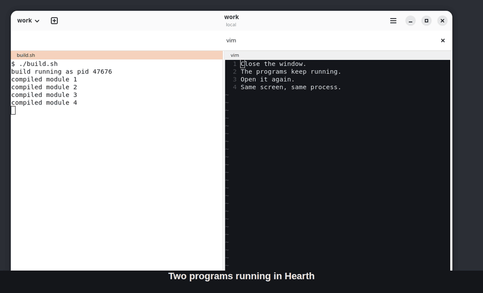

# Hearth



A terminal workspace for Linux where a per-user server owns your shells.

```sh
curl -fsSL https://github.com/jayhemnani9910/hearth/releases/latest/download/hearth_amd64.deb -o /tmp/hearth.deb && sudo apt install -y /tmp/hearth.deb
```

[](https://github.com/jayhemnani9910/hearth/actions/workflows/ci.yml)
[](LICENSE)

Then run `hearth-app`. Close the window, reconnect later (locally, over SSH,
or over your tailnet), and the same programs are still running, with exact
screen state.

The package is built for Ubuntu 26.04 on amd64 with GNOME on Wayland, which is
the only setup tested. The server, CLI and GTK desktop app work, and
[docs/PARITY.md](docs/PARITY.md) lists what has been verified and what has not.

Know this before you rely on it:

- Programs survive the window closing and the link dropping, as long as the
  server lives. After a server restart the layout comes back with new shells.
- Surviving a logout depends on systemd lingering and is untested.
- Real SSH between two machines and real Tailscale are untested. The tests use
  a local proxy and a stub.
- The idea comes from Superlogical's Rex. Hearth is a separate project, shares
  no code with it, and can't talk to Rex servers.

## Install

The command at the top installs the latest release. To build the package
yourself:

```sh
packaging/build-deb.sh                      # -> dist/hearth_<version>_amd64.deb
sudo apt install ./dist/hearth_*_amd64.deb
```

This installs `hearthd`, `hearth`, `hearth-app`, a systemd user unit
(`hearth.service`, started on demand) and a desktop entry. After an upgrade,
running servers keep the old version until `systemctl --user restart hearth`
(programs restart, the layout is kept).

## Build

Requires Ubuntu 26.04, Rust 1.94 or newer, and
`libgtk-4-dev libadwaita-1-dev libvte-2.91-gtk4-dev`.

```sh
cargo build --release
cargo build && cargo test      # tests use the built binaries
packaging/test-package.sh dist/hearth_*_amd64.deb
```

The GUI tests need `gtk4-broadwayd` (package `libgtk-4-bin`); they run
headless.

## Desktop app

`hearth-app` opens the first session on this computer, starting the server
and a session if needed. `--host ssh:me@box` connects elsewhere and
`--session NAME` picks a session. Closing the window leaves everything
running.

| Keys | Action |
| --- | --- |
| Ctrl+Shift+T / Ctrl+Shift+N | new tab / new window (new session) |
| Ctrl+Shift+D / Ctrl+Shift+E | split right / split down |
| Ctrl+Shift+W | close pane |
| Alt+Arrows | move focus between panes |
| Ctrl+Shift+Z | zoom pane |
| Ctrl+PageUp / Ctrl+PageDown | previous / next tab |
| Ctrl+Shift+P | command palette (built-ins, config actions, sessions) |
| Ctrl+Shift+S | switch session |
| Ctrl+Shift+C / Ctrl+Shift+V | copy / paste |

Bindings, chord sequences (`hearth.bind("ctrl+a c", "new-tab")`) and modes
from `config.lua` replace or add to these. `--remote-control`, or the menu
item, lets `hearth api call client.action` drive the window.

## Use

```sh
hearth new -n work            # starts the server if needed, new session
hearth ls
hearth split -t b2 -d right -- htop
hearth run -p window --wait -- make test
hearth attach -t b2           # view a terminal here; Ctrl-] detaches
hearth capture -t b2 --history
hearth --host ssh:me@box ls   # another machine (needs hearth installed there)
```

Inside a Hearth terminal, `$HEARTH_SESSION` and `$HEARTH_BLOCK` are set and
commands target them by default.

Configuration goes in `~/.config/hearth/config.lua`:

```lua
hearth.bind("ctrl+shift+t", "new-tab")
hearth.host{ name = "box", address = "ssh:me@box" }
hearth.action{ name = "dev", title = "Dev layout",
  args = { { name = "dir", type = "string", required = true } },
  run = function(a)
    local s = hearth.api.session_create{ name = "dev", cwd = a.dir }
    hearth.api.block_split{ block = s.block, direction = "right", cwd = a.dir, command = { "npm", "run", "dev" } }
  end }
-- opt-in tailnet listener; identity via `tailscale whois`
-- hearth.set{ listen = { "tcp:100.64.0.1:7701" }, allow = { "me@example.com" } }
```

Further reading:

- [docs/DECISIONS.md](docs/DECISIONS.md): architecture decisions.
- [docs/PROTOCOL.md](docs/PROTOCOL.md): the wire protocol.
- [CHANGELOG.md](CHANGELOG.md) and [CONTRIBUTING.md](CONTRIBUTING.md).

## License

MIT. Dependencies keep their own licenses: alacritty_terminal is Apache-2.0,
Lua is MIT, and GTK/libadwaita/VTE are LGPL. The package ships every bundled
crate's notice in `/usr/share/doc/hearth/THIRD-PARTY-LICENSES.gz`.
